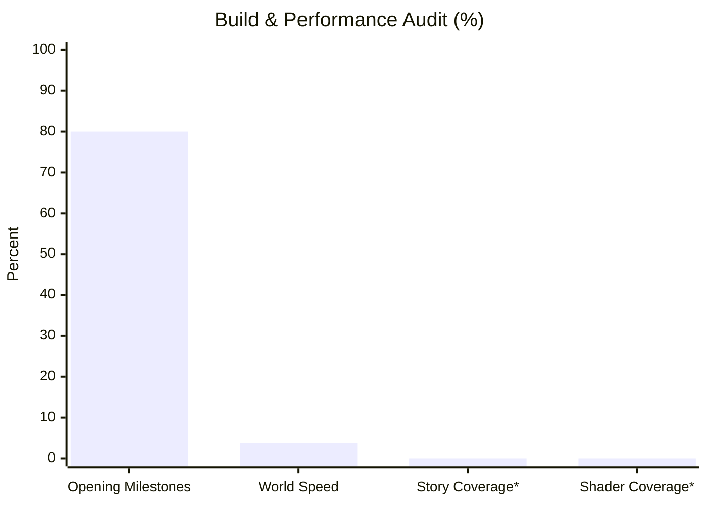

<div align="center">

# VIctory Render Lab

**An RTX 4060 compatibility and rendering project based on VIctory and Vice-Tay**


[Results](#local-results) · [What this repo adds](#what-this-repo-adds) · [Setup](#getting-started) · [Credits](#credits)

</div>

## Local results

**The opening world reached the screen on the RTX 4060.** In the latest captured local run, Lucia, her hair, nearby characters, interior surfaces, and the sunlit yard were visible in the presented image. An earlier local capture showed geometry in the intermediate buffers and a black presented frame. Reaching the visible scene is the project's clearest rendering milestone so far.



*Story and shader coverage are unmeasured. Their zero bars are placeholders.*

| Check | Progress | Evidence |
| --- | --- | --- |
| Opening milestones | 🟢🟢🟢🟢⚪ **4/5 · 80%** | Boot, title card, visible character, and lit environment observed. Repeatable completion at the performance target is open. |
| World speed | 🟠⚪⚪⚪⚪ **3.7% of target** | The last 17 logged samples had a median of **1.1 FPS** against a **30 FPS** development target. Range **0.2–3.0 FPS**. |
| Full story and feature coverage | ⚪ **Unmeasured** | No local mission-by-mission or feature-by-feature audit has been completed. |
| Current shader coverage | ⚪ **Unmeasured** | The integrated revision still needs a fresh shader census. |

Each green dot in the opening row is one completed checklist item. The orange dot marks a measured performance shortfall. These metrics describe the local experiment. The FPS figure is a median of log samples. The opening checklist covers five milestones and gives no estimate of total game completion.

**Local run configuration.** RTX 4060, Series S profile, DLSS Quality, a 1920×1080 window cap, a 40 ms texture staging budget, and the launcher's shader-skip profile. The visual result is for that configuration. The capture confirms a visible scene, and the log still shows major frame-time spikes and dropped indirect commands.

## What this repo adds

- **A local RTX 4060 renderer integration.** Combined the local compatibility work with the Vice-Tay renderer baseline and added a lower-memory launch profile. The visible scene is the outcome of the combined build. The run did not isolate a single change as its cause.
- **Pipeline warm-up in the Windows launcher.** The RTX 4060 profile records and warms pipelines used in previous runs. Optional priming prepares those pipelines on the title's own D3D12 device before startup, trading startup time and retained memory for readiness during play.
- **Shader and descriptor compatibility work.** The local work included bounds checks for smaller descriptor heaps and fixes to DXIL metadata for graphics UAVs and compute derivatives.
- **Diagnostics that pinpointed the black frame.** Local render-target captures showed world geometry behind a black presented image. Offline D3D12 probes confirmed that specific compute pipelines requested 64-lane waves on the 32-lane GPU. These checks separated shader acceptance, pipeline creation, and what finally reached the screen.

## Getting started

Use Windows x64, an AVX2-capable CPU, a D3D12 GPU with Shader Model 6.6 and mesh shader support, Rust, and MSVC build tools with a Windows SDK.

```powershell
git clone https://github.com/Snatukins/victory-render-lab.git
Set-Location victory-render-lab
Copy-Item .\victory.example.toml .\victory.toml
cargo build --locked --profile diag -p victory --features diagnostics
.\scripts\play.ps1 -Exe 'D:\path\to\your\title.exe' -Machine 4060 -Console series-s
```

Set `game_dir` in `victory.toml` to your title directory. See [local test procedures](docs/tests.md), [architecture](docs/architecture.md), and [the asset policy](docs/asset-policy.md). Bring your own title files and keep captures, recordings, and derived caches outside the repository.

## Credits

- **Snatukins** drove local RTX 4060 testing, reported what appeared on screen, and directed later integration and performance experiments.
- **Codex-assisted local development** worked on descriptor bounds, shader metadata, capture diagnostics, and RTX 4060 launcher and cache integration. The optional priming edits came from the local working tree.
- **Marvisak and the VIctory contributors** built the compatibility layer. **Taynan Piza / TaynanGT and the Vice-Tay contributors** developed the imported renderer baseline. **Maxime Cambou** contributed NVIDIA profile tuning and reduced CPU waits for compatible fills.
- Original authorship and imported commits are preserved. See the [full upstream contributor credits](docs/credits.md) and [GPL-3.0-or-later license](LICENSE).

[VIctory upstream](https://github.com/Marvisak/VIctory) · [Vice-Tay upstream](https://github.com/TaynanGT/Vice-Tay)
