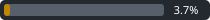

<div align="center">

# VIctory Render Lab

**Bringing Xbox Series rendering to PCs with older CPUs and modest NVIDIA GPUs**


[Why this exists](#why-this-exists) · [Results](#local-results) · [Roadmap](#roadmap) · [Setup](#getting-started) · [Credits](#credits)

</div>

## Why this exists

When an Xbox game runs through VIctory on a PC, the compatibility layer translates the game's graphics instructions into work Windows and the graphics card can run. Vice-Tay gave us a renderer that could already draw the opening, with a major benchmark on an RTX 4090. We used that foundation to tackle a different problem: getting a visible, responsive game on PCs with less room to spare.

**Our first test target is the RTX 4060. Our broader goal is to make the renderer practical on older CPUs and more modest NVIDIA hardware.** A slower CPU has less time to prepare each frame. A smaller graphics card has less memory for textures and buffers. When the renderer copies those assets back and forth or prepares shaders during a scene, the result can be long pauses, missing visuals, and audio that continues while the picture barely moves.

This branch matters because a renderer that works on high-end hardware is only the starting point for those players. Our local milestone is a lit story scene with characters and scenery visible. The next milestone is keeping that image intact while making each frame substantially cheaper.

## Local results

**The opening world reached the screen on the RTX 4060.** In the latest captured local run, Lucia, her hair, nearby characters, interior surfaces, and the sunlit yard were visible in the presented image. An earlier local capture showed geometry in the intermediate buffers and a black presented frame. Reaching the visible scene is the project's clearest rendering milestone so far.

| Check | Progress | Evidence |
| :--- | :--- | :--- |
| **Opening milestones** |  | Boot, title card, visible character, and lit environment observed. Repeatable completion at the performance target is open. |
| **World speed** |  | The last 17 logged samples had a median of **1.1 FPS** against a **30 FPS** development target. Range **0.2–3.0 FPS**. |
| **Full story and feature coverage** |  | No local mission-by-mission or feature-by-feature audit has been completed. |
| **Current shader coverage** |  | The integrated revision still needs a fresh shader census. |

**Local run configuration.** RTX 4060, Series S profile, DLSS Quality, a 1920×1080 window cap, a 40 ms texture staging budget, and the launcher's shader-skip profile. The capture confirms a visible scene, and the log still shows major frame-time spikes and dropped indirect commands.

## What this repo adds

- **A local RTX 4060 renderer integration.** Combined the local compatibility work with the Vice-Tay renderer baseline and added a lower-memory launch profile. The visible scene is the outcome of the combined build. The run did not isolate a single change as its cause.
- **Memory allocation and streaming.** The RTX 4060 profile limits memory pressure as the world loads. The renderer reuses existing host-side buffer copies when they cover the requested range, refreshes tracked memory where pages changed, and reclaims unused copies as streamed data changes. Reserved descriptor slots also give shaders a safe fallback when the GPU cannot mirror the full console heap. These changes help smaller PCs stay within their RAM and VRAM budgets, and memory-heavy scenes still need more tuning.
- **Pipeline warm-up in the Windows launcher.** The RTX 4060 profile records and warms pipelines used in previous runs. Optional priming prepares those pipelines on the title's own D3D12 device before startup, trading startup time and retained memory for readiness during play.
- **Shader and descriptor compatibility work.** The local work included bounds checks for smaller descriptor heaps and fixes to DXIL metadata for graphics UAVs and compute derivatives.
- **Diagnostics that pinpointed the black frame.** Local render-target captures showed world geometry behind a black presented image. Offline D3D12 probes confirmed that specific compute pipelines requested 64-lane waves on the 32-lane GPU. These checks separated shader acceptance, pipeline creation, and what finally reached the screen.

## Roadmap

| Priority | What we want to achieve |
| --- | --- |
| **Make the picture reliable** | Keep characters, lighting, and backgrounds visible across the opening and verify progress through repeatable runs. |
| **Give older CPUs less work** | Prepare frequently used pipelines ahead of time and reduce repeated memory copies and CPU waits during gameplay. |
| **Fit smaller GPUs** | Keep frequently reused graphics data in video memory where it helps, within a budget that leaves room for streaming. |
| **Try DLSS Frame Generation** | On supported NVIDIA hardware, test DLSS Frame Generation as the preferred path and phase out FSR frame generation from this project's default NVIDIA profile once the replacement is verified. Report rendered FPS and generated presentation FPS separately. |

Our goal is to outperform other VIctory builds **on comparable lower-spec hardware**, using the same scene and settings. DLSS Frame Generation is planned. The first performance milestone is a steadier base frame rate from the renderer itself.

## Getting started

Use Windows x64, an AVX2-capable CPU, a D3D12 GPU with Shader Model 6.6 and mesh shader support, Rust, and MSVC build tools with a Windows SDK.

```powershell
git clone https://github.com/Snatukins/victory-render-lab.git
Set-Location victory-render-lab
Copy-Item .\victory.example.toml .\victory.toml
cargo build --locked --profile diag -p victory --features diagnostics
.\scripts\play.ps1 -Exe 'D:\path\to\your\title.exe' -Machine 4060 -Console series-s
```

Set `game_dir` in `victory.toml` to your title directory. See [local test procedures](docs/tests.md), [architecture](docs/architecture.md), and [the asset policy](docs/asset-policy.md). Bring your own title files and keep captures, recordings, and derived caches outside the repository.

## Credits

- **[Snatukins](https://github.com/Snatukins)** leads VIctory Render Lab, including the RTX 4060 renderer integration, launcher and pipeline-cache work, and local graphics and performance testing.
- **Marvisak and the VIctory contributors** built the compatibility layer. **Taynan Piza / TaynanGT and the Vice-Tay contributors** developed the imported renderer baseline. **Maxime Cambou** contributed NVIDIA profile tuning and reduced CPU waits for compatible fills.
- Original authorship and imported commits are preserved. See the [full upstream contributor credits](docs/credits.md) and [GPL-3.0-or-later license](LICENSE).

[VIctory upstream](https://github.com/Marvisak/VIctory) · [Vice-Tay upstream](https://github.com/TaynanGT/Vice-Tay)
